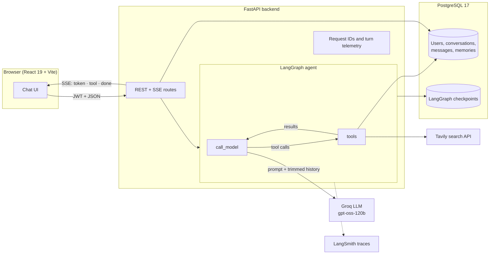

# Curibot

**A stateful AI chat agent with web search, long-term memory, and streaming
replies, built with FastAPI, LangGraph, and React.**

Curibot remembers your conversations and the facts you share about yourself,
searches the web when a question needs live information, and streams its
answers token by token with cited sources.


## Highlights

- **Agent loop with LangGraph.** The model decides for itself when to call a
  tool. Tool results flow back into the graph, with a round limit that forces
  an answer even from models that ignore `tool_choice`.
- **Live web search with Tavily.** Time-sensitive questions are answered from
  current results with source links. Search output is treated as untrusted
  content to guard against prompt injection.
- **Long-term memory.** Curibot saves lasting facts and preferences (name,
  role, how you like answers) and uses them in every conversation. You can
  review and forget them in a Memory panel.
- **Streaming that feels smooth.** Replies arrive over Server-Sent Events and
  are revealed at a steady, adaptive pace, rendered as Markdown with tables
  and code. A status line shows "Searching the web…" or "Remembering…" while
  tools run.
- **Stateful by design.** Messages persist in PostgreSQL and graph state in a
  LangGraph checkpointer. Long histories are trimmed to a token budget, and
  the full transcript is always kept.
- **Observable and privacy-safe.** Structured JSON logs with request IDs and a
  per-turn summary of tools, latency, and tokens, with no message content.
  Optional LangSmith traces can be found from any log line.
- **Polished, accessible UI.** Dark mode with a system-aware theme switcher, a
  mobile drawer, keyboard focus management, native `<dialog>` modals, and
  WCAG AA contrast.

## Architecture



**One chat turn:**

1. The browser posts the message and opens a Server-Sent Events stream.
2. The backend locks the conversation, loads its history, and reuses the
   LangGraph checkpoint when it matches the saved transcript.
3. `call_model` receives a fresh system prompt (identity, today's date, tool
   guidance, the user's memories) plus history trimmed to a token budget.
4. The model answers or calls tools (`web_search`, `save_memory`,
   `delete_memory`). Results go back to the model, up to a round limit.
5. Tokens stream to the browser as `token` events, and tool use streams as
   `tool` events. The final answer is saved and sent as `done`.

## Tech stack

| Area | Technology |
| --- | --- |
| Frontend | React 19, TypeScript, Vite, plain CSS with light/dark design tokens, `react-markdown` |
| Backend | Python 3.13, FastAPI, SQLAlchemy 2, Alembic, Pydantic settings |
| AI | LangGraph, LangChain, Groq (`openai/gpt-oss-120b`), Tavily search |
| Data | PostgreSQL 17, LangGraph Postgres checkpointer with a connection pool |
| Auth | JWT bearer tokens, Argon2 password hashing |
| Observability | Structured JSON logging, request IDs, LangChain callback telemetry, LangSmith (optional) |
| Tooling | uv, Ruff, mypy (strict), pytest, ESLint, Vitest and Testing Library, Docker Compose |

## Quick start

**Prerequisites:** Docker with Docker Compose, a [Groq](https://console.groq.com)
API key, and optionally a [Tavily](https://tavily.com) key for web search.

```bash
git clone https://github.com/jaiganesh-vr/Curibot.git
cd Curibot
cp .env.example .env
```

Edit `.env`: set `POSTGRES_PASSWORD`, a random `JWT_SECRET_KEY` (32 or more
characters), and `GROQ_API_KEY`. Then start everything:

```bash
docker compose up --build
```

| Service | URL |
| --- | --- |
| App | <http://localhost:5173> |
| API | <http://localhost:8000> (interactive docs at `/docs`) |
| Health | <http://localhost:8000/health/ready> |

Database migrations run automatically when the backend starts. Register an
account in the app and start chatting.

## Configuration

All settings come from the root `.env` file (see [`.env.example`](.env.example)).

| Variable | Required | Purpose |
| --- | --- | --- |
| `POSTGRES_PASSWORD` | Yes | Database password |
| `JWT_SECRET_KEY` | Yes | Signs access tokens; 32+ characters in production |
| `GROQ_API_KEY` | Yes | LLM access |
| `GROQ_MODEL` | No | Defaults to `openai/gpt-oss-120b` |
| `TAVILY_API_KEY` | No | Enables web search; leave empty to disable |
| `WEB_SEARCH_MAX_RESULTS`, `WEB_SEARCH_MAX_ROUNDS` | No | Search breadth and the tool round limit per question |
| `MEMORY_ENABLED` | No | Long-term memory (default `true`) |
| `CONTEXT_MAX_TOKENS` | No | History sent to the model per turn (default 16,000) |
| `ACCESS_TOKEN_EXPIRE_MINUTES` | No | Session length (default 30) |
| `LOG_LEVEL`, `LOG_FORMAT` | No | Logging; `json` in Docker, `text` locally |
| `LANGSMITH_TRACING`, `LANGSMITH_API_KEY`, `LANGSMITH_PROJECT` | No | Optional tracing; traces include message content |

## API overview

All routes are under `/api/v1` and, except registration and login, require a
bearer token.

| Method | Path | Purpose |
| --- | --- | --- |
| `POST` | `/auth/register`, `/auth/login` | Create an account, get a token |
| `GET` | `/auth/me` | Current user |
| `GET`, `POST` | `/conversations` | List or create conversations |
| `PATCH`, `DELETE` | `/conversations/{id}` | Rename or delete |
| `GET` | `/conversations/{id}/messages` | History |
| `POST` | `/conversations/{id}/messages/stream` | Send a message and stream the reply (SSE) |
| `GET`, `DELETE` | `/memories`, `/memories/{id}` | Review, forget, or clear memories |

## Testing

Tests run without network access. Language models, the search API, and HTTP
are replaced with scripted fakes.

```bash
# Backend: 171 tests (run from backend/)
uv run pytest -q
uv run ruff check . && uv run mypy app

# PostgreSQL integration tests (row locking, checkpoint recovery)
TEST_DATABASE_URL=postgresql://app:<password>@localhost:5432/conversation_agent_test \
  uv run pytest -q tests/test_postgres_concurrency.py

# Frontend: 86 tests (run from frontend/)
npx vitest run
npm run lint && npm run typecheck && npm run build
```

Coverage includes the agent loop and round limit, streaming events,
checkpoint consistency, memory isolation between users, the SSE parser,
accessibility behaviour such as focus management and dialogs, and a test that
logs never contain message content.

## Design decisions

- **The system prompt is never stored.** It is added to the model input on
  every turn, never written to the checkpoint or database, so editing it
  applies to every conversation, including old ones.
- **Trim what the model sees, never what is saved.** History is cut to a
  token budget at a user-turn boundary, without separating a tool call from
  its result. The database and the UI keep everything.
- **A small `httpx` Tavily tool instead of an SDK.** About 60 lines with no
  extra dependencies. Outages return a message to the model, so the turn
  still completes.
- **Force answers without tools.** At the round limit the model is called
  with no tools bound, and this turn's results move into the prompt. Some
  models still emit a tool call under `tool_choice="none"`, which the
  provider then rejects.
- **Memory writes share the turn's transaction.** If a turn fails, nothing it
  saved persists. Database access from parallel tool threads is serialized
  with a lock.
- **A workspace keyed by user.** On sign-out React unmounts all signed-in
  state at once, instead of resetting it piece by piece.
- **Logs carry identifiers, not content.** Request, user, and conversation IDs,
  timings, and token counts only. HTTP and LLM client loggers are pinned to
  `WARNING`, so debug logging cannot leak request bodies.

## Project structure

```text
├── backend/
│   ├── app/
│   │   ├── api/routes/        # auth, conversations, memories
│   │   ├── core/              # settings, security, logging, request middleware
│   │   ├── models/, schemas/  # SQLAlchemy models, Pydantic schemas
│   │   └── services/          # chat graph, prompts, tools, memory, telemetry
│   ├── migrations/            # Alembic
│   └── tests/
├── frontend/                  # React app (see frontend/README.md)
│   └── src/{components,hooks,lib,api}
├── docs/observability.md      # Logs, telemetry, and LangSmith
└── compose.yaml
```

## Further reading

- [Frontend README](frontend/README.md): UI features, scripts, and layout
- [Observability guide](docs/observability.md): log events, `jq` queries,
  privacy, and LangSmith tracing
